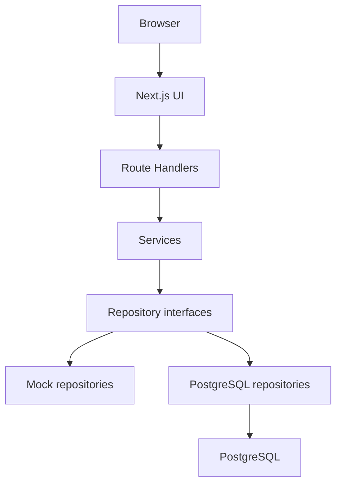
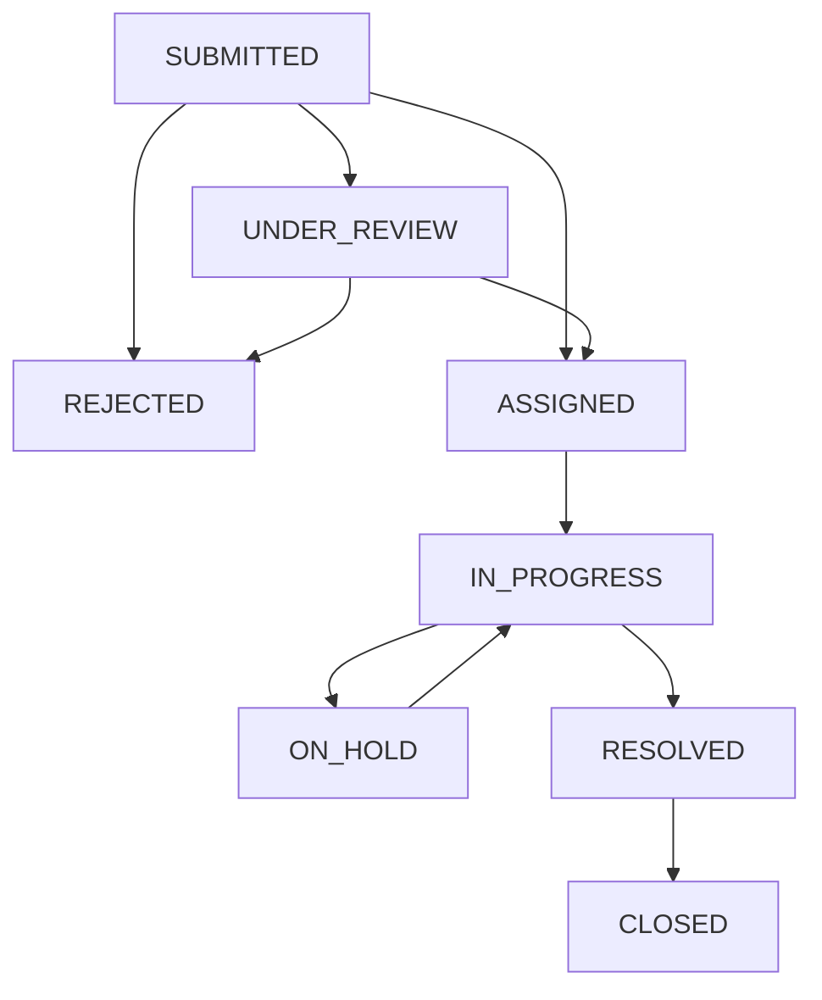

# Architecture

## Request path

`DATA_PROVIDER` selects `mock` (the default) or `postgres`. PostgreSQL records are durable. Mock records live in arrays in one Node process.

## Responsibilities

- `src/components`: forms, tables, filters, navigation and API calls. No array store imports or data-access code.
- Protected server pages use the auth provider to identify the session and check page permissions, then render the workspace.
- `src/app/api/**/route.ts`: explicit Next.js handlers delegate to the shared HTTP adapter in `src/lib/api.ts`. It parses JSON, checks the session and origin, translates validation/service errors into HTTP responses and invokes services.
- Services own domain validation, permissions, complaint visibility, workflow transitions and relationships.
- Repository interfaces define asynchronous typed CRUD for all 14 entities. The specialized ComplaintRepository also exposes reporter lookup/status updates. The current services use the shared CRUD contract.
- Mock repositories implement the contracts against the seeded Store. Returned records are cloned so UI/service reads do not mutate stored rows accidentally.
- `src/repositories/index.ts` is the repository composition point; it validates DATA_PROVIDER and selects the corresponding implementation.
- `src/repositories/postgres/` implements all 14 repositories using fixed table/column identifiers and parameterized values.

## Complaint state rules

A manager may assign directly from submitted or under review. The technician accepts the assignment before starting work. Acceptance changes assignment state but leaves complaint state ASSIGNED. Completing requires an IN_PROGRESS assignment and at least one work log. Reassignment cancels the previous active assignment and returns the complaint to ASSIGNED. Terminal complaints cannot be reassigned. Feedback is allowed after RESOLVED or CLOSED, only for the reporter, once per complaint.

Status history records actor, previous/current status and timestamp. Assignment history preserves canceled jobs. Mock availability is derived from all open jobs for a technician. BUSY is informational and does not cap workload. OFF_DUTY and ON_LEAVE prevent new assignments.

## Authentication and authorization

The AuthProvider boundary in `src/lib/auth.ts` permits a real provider later. Demo login selects an active User ID and generates a cryptographically random session token. The cookie contains no user role or trusted client data, is HttpOnly/SameSite Lax, uses Secure in production and expires in eight hours. Logout invalidates the server token. Account status is rechecked for each request.

Demo role selection is intentionally public, so this is not production authentication. No passwords are stored or hashed. Real password hashing, credential verification, login rate limiting, durable sessions and onboarding remain future integration work. Sessions remain in memory and require a single Node process (or sticky sessions); PostgreSQL records persist independently of the app process.

The service layer checks permissions and ownership, not just navigation. Student/faculty reads are scoped to their own complaints. Technician reads are scoped to their non-canceled, non-reassigned assignments; mutation requires ownership and a suitable assignment state. Managers/admins can review all complaints. Only admins manage directory records. Mutation requests require JSON and reject mismatched Origin values. React renders user strings as text; no raw HTML rendering is used.

## Mock consistency and database replacement

`serialize()` queues mock API mutations inside one process, preventing two material requests from reading the same stock before deduction or two feedback requests from both passing uniqueness checks. This does not offer durable rollback and does not coordinate multiple workers.

PostgreSQL mutations enter `runMutation()` in the HTTP adapter after authentication. `transaction()` checks out one connection, begins a transaction, takes a transaction-scoped advisory lock, and sets the audit actor. `AsyncLocalStorage` routes every repository call in that operation to the same client. Success commits; any error rolls back; the client is released in `finally`.

The advisory lock coordinates application writes across processes. This is deliberately simple for a small campus workload. It can be replaced by per-entity locks for scale, with new concurrency tests. Inventory additionally locks the stock row in its SQL trigger, and feedback has a unique constraint. Direct SQL clients must manage their own transaction coordination.

`databaseManagedEffects` tells the services that triggers own complaint history and inventory reduction. The repository omits generated material totals. Assignment triggers synchronize status on start and completion. `05_app_compatibility.sql` extends held assignments and workload counting without changing the user's original four files. On active reassignment the service transitions through ON_HOLD before a new assignment sets ASSIGNED, matching the SQL's allowed transition graph.

All application writes require a transaction; repository calls made outside one are rejected. If new background jobs call these services, wrap their mutations in `runMutation(actorId, operation)` too. Reads continue using pooled connections. Timestamp-without-time-zone fields are UTC strings and numeric fields become JSON numbers.

Refer to [database setup](../database/README.md) and [verification](VERIFICATION.md) for operational steps and test coverage.

## Extending the UI

`Workspace.tsx` selects a role-appropriate screen from the explicit page path; shared components keep tables and details consistent. `Shell.tsx` supplies navigation. The forms use HTML validation and services parse strict Zod inputs independently, so direct API clients receive the same validation rules.
