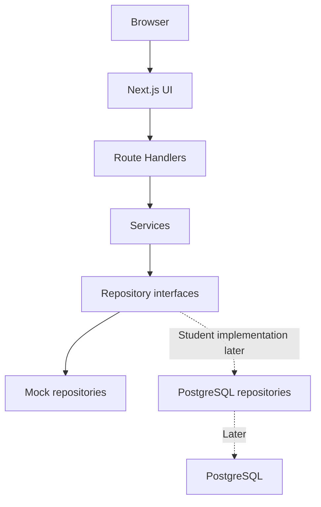
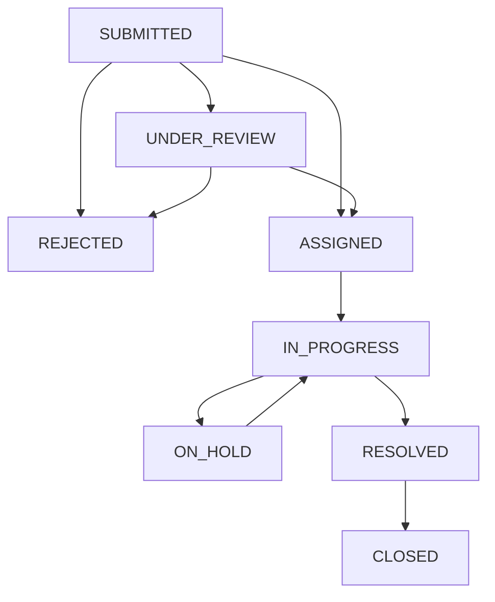

# Architecture

## Request path

The database path does not exist yet. All runtime records live in arrays in one Node process.

## Responsibilities

- `src/components`: forms, tables, filters, navigation and API calls. No array store imports or data-access code.
- Protected server pages use the auth provider to identify the session and check page permissions, then render the workspace.
- `src/app/api/**/route.ts`: explicit Next.js handlers delegate to the shared HTTP adapter in `src/lib/api.ts`. It parses JSON, checks the session and origin, translates validation/service errors into HTTP responses and invokes services.
- Services own domain validation, permissions, complaint visibility, workflow transitions and relationships.
- Repository interfaces define asynchronous typed CRUD for all 14 entities. The specialized ComplaintRepository also exposes reporter lookup/status updates. The current services use the shared CRUD contract.
- Mock repositories implement the contracts against the seeded Store. Returned records are cloned so UI/service reads do not mutate stored rows accidentally.
- `src/repositories/index.ts` is the repository composition point; it rejects unsupported DATA_PROVIDER values rather than silently connecting to a database.
- `src/repositories/postgres/` has TODO-only files. Students author all database access.

## Complaint state rules

A manager may assign directly from submitted or under review. The technician accepts the assignment before starting work. Acceptance changes assignment state but leaves complaint state ASSIGNED. Completing requires an IN_PROGRESS assignment and at least one work log. Reassignment cancels the previous active assignment and returns the complaint to ASSIGNED. Terminal complaints cannot be reassigned. Feedback is allowed after RESOLVED or CLOSED, only for the reporter, once per complaint.

Status history records actor, previous/current status and timestamp. Assignment history preserves canceled jobs. Mock availability is derived from all open jobs for a technician. BUSY is informational and does not cap workload. OFF_DUTY prevents new assignments.

## Authentication and authorization

The AuthProvider boundary in `src/lib/auth.ts` permits a real provider later. Demo login selects an active User ID and generates a cryptographically random session token. The cookie contains no user role or trusted client data, is HttpOnly/SameSite Lax, uses Secure in production and expires in eight hours. Logout invalidates the server token. Account status is rechecked for each request.

Demo role selection is intentionally public, so this is not production authentication. No passwords are stored or hashed. Real password hashing, credential verification, login rate limiting, durable sessions and onboarding remain future integration work. Sessions and data are in-memory and require a single Node process.

The service layer checks permissions and ownership, not just navigation. Student/faculty reads are scoped to their own complaints. Technician reads are scoped to their non-canceled assignments; mutation requires ownership and a suitable assignment state. Managers/admins can review all complaints. Only admins manage directory records. Mutation requests require JSON and reject mismatched Origin values. React renders user strings as text; no raw HTML rendering is used.

## Mock consistency and database replacement

`serialize()` queues mock API mutations inside one process, preventing two material requests from reading the same stock before deduction or two feedback requests from both passing uniqueness checks. This does not offer durable rollback and does not coordinate multiple workers.

Students must implement a shared database transaction for every multi-entity change. Inventory requires row locking or an equivalent conditional update. Feedback needs a unique constraint. Assignment updates require complaint/assignment concurrency control. If status history is moved into a database trigger, remove duplicate application history writes. Rollback and concurrent tests belong in the student database integration.

Keep API response shapes stable. Replace the repository objects in `src/repositories/index.ts`, retain service validation and move data-specific behavior into repository/query implementations. Do not merely activate a new DATA_PROVIDER value without implementations and integration tests.

## Extending the UI

`Workspace.tsx` selects a role-appropriate screen from the explicit page path; shared components keep tables and details consistent. `Shell.tsx` supplies navigation. The forms use HTML validation and services parse strict Zod inputs independently, so direct API clients receive the same validation rules.
